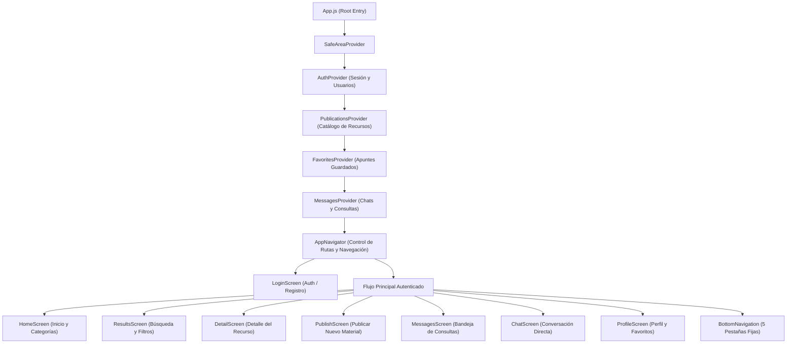
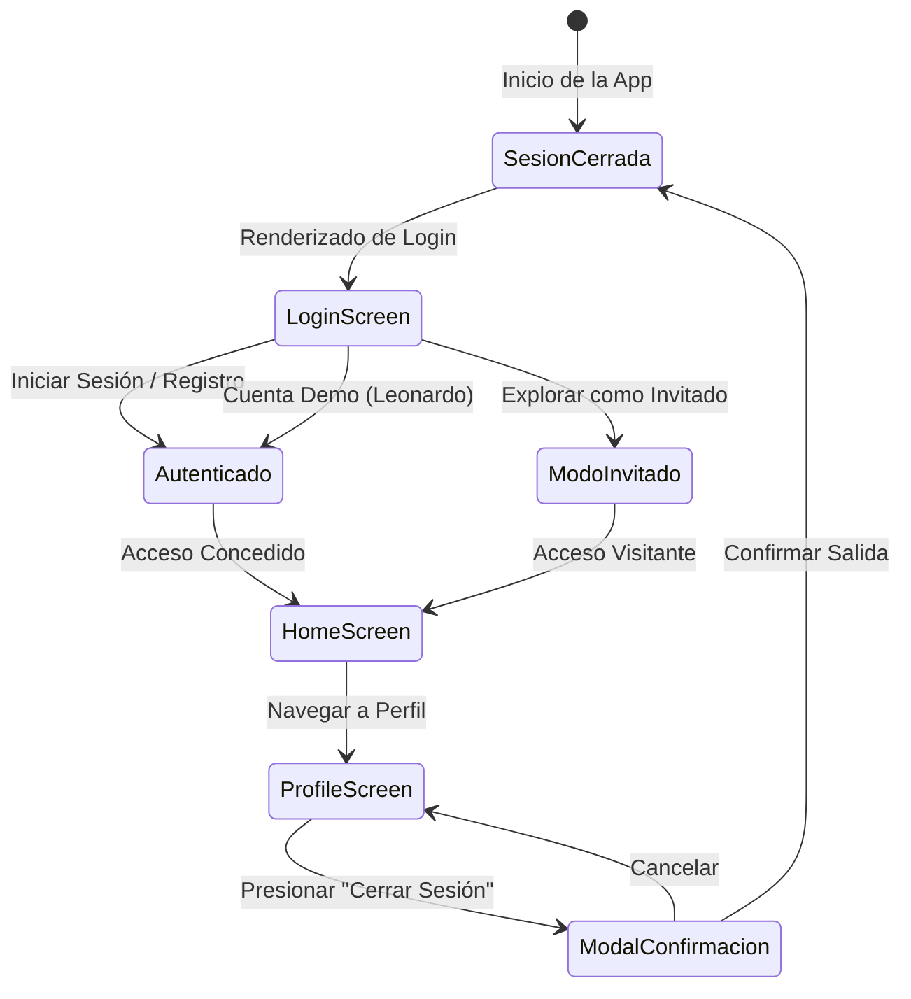
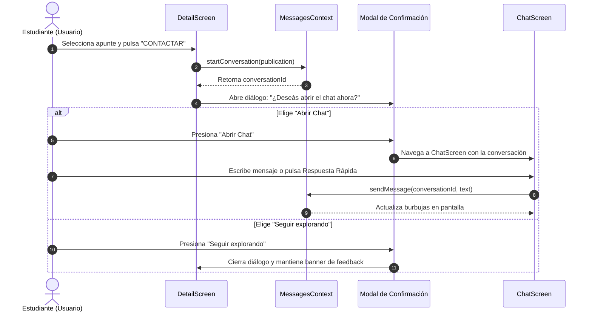

# SOFTWARE DESIGN DOCUMENT (SDD)
## SISTEMA DE GESTIÓN Y CENTRALIZACIÓN DE RECURSOS ACADÉMICOS
# UNIAPUNTES — "Compartí conocimiento. Encontrá lo que necesitás."

---

### METADATOS DEL PROYECTO
- **Institución:** Universidad Nacional del Pilar (UNP)
- **Carrera:** Tecnicatura Universitaria en Desarrollo de Software
- **Cátedra:** Aplicaciones Móviles
- **Año Académico:** 2026
- **Docente a Cargo:** Prof. Ariel Bulacio
- **Versión del Documento:** 2.0 (Versión Final de Arquitectura y Diseño)
- **Estado:** Especificación y Sistema Completo Implementado

---

## 1. INTRODUCCIÓN Y ALCANCE

### 1.1 Propósito del Documento
El presente Documento de Diseño de Software (SDD) tiene como finalidad formalizar las decisiones de arquitectura, modelado de datos, jerarquía de componentes, gestión de estados y diseño de interacción para la aplicación móvil **UniApuntes**. Sirve como guía de referencia técnica para el equipo de desarrollo, evaluación académica y futuras extensiones del sistema.

### 1.2 Problema que Resuelve
En la vida universitaria contemporánea, los apuntes de clase, resúmenes de parciales, recomendaciones bibliográficas y ofertas de asesorías académicas entre pares se encuentran atomizados en canales no estructurados e informales:
- Grupos de mensajería instantánea (WhatsApp, Telegram) con pérdida recurrente de archivos por expiración o saturación de almacenamiento.
- Redes sociales con baja indexación temática y nula búsqueda semántica por materia o cátedra.
- Contactos personales directos que excluyen a ingresantes o estudiantes con menor red social.

### 1.3 Solución Propuesta
**UniApuntes** centraliza el acervo académico estudiantil en una plataforma móvil accesible, rápida, categorizada y orientada a la comunidad universitaria. Su modelo de operación promueve el acceso libre, gratuito y colaborativo al conocimiento universitario.

### 1.4 Alcance Técnico
La aplicación se concibe como una solución cliente-móvil nativa multiplataforma (Android, iOS y Web) impulsada por **React Native** y **Expo**, con arquitectura modular basada en componentes y gestión de estado mediante **React Context API**, sincronización en la nube en tiempo real mediante **Google Firebase (Cloud Firestore y Firebase Authentication)** y persistencia resiliente offline en almacenamiento local (`AsyncStorage`).

---

## 2. ARQUITECTURA DEL SISTEMA

### 2.1 Patrón Arquitectónico General
La arquitectura adopta el patrón **Component-Based Modular Architecture** complementado con **Unidirectional Data Flow (UDF)** y **Provider Pattern**:



### 2.2 Principios de Diseño Aplicados
1. **Separación de Responsabilidades (SoC):** Desacople estricto entre lógica de presentación (`screens/`), componentes reutilizables (`components/`), estado global (`context/`), estilos de diseño (`styles/`) y fuentes de datos (`data/`).
2. **Atomicidad de Componentes:** Componentes pequeños, puros y reutilizables (`SearchBar`, `CategoryCard`, `PublicationCard`, `FilterButton`, `PrimaryButton`).
3. **Resiliencia Offline:** Capacidad de operar sin conectividad continua mediante precarga en memoria y sincronización con el motor de almacenamiento local del dispositivo.

---

## 3. MODELO DE DATOS Y ESQUEMAS

### 3.1 Entidad: Usuario (`User`)
```typescript
interface User {
  id: string | number;
  nombre: string;
  email: string;
  carrera: string;
  universidad: string;
  rol: 'Estudiante' | 'Docente' | 'Invitado';
  isGuest: boolean;
  avatarUrl?: string;
}
```

### 3.2 Entidad: Publicación / Recurso Académico (`Publication`)
```typescript
interface Publication {
  id: string | number;
  titulo: string;
  tipo: 'Apuntes' | 'Asesoría' | 'Cursos' | 'Resúmenes';
  materia: string;
  autor: string;
  rating: number; // escala 1.0 - 5.0
  precio: 'GRATIS';
  descripcion: string;
  archivoAdjunto?: string | null;
  fecha?: string;
}
```

### 3.3 Entidad: Conversación (`Conversation`)
```typescript
interface Conversation {
  id: string;
  authorName: string;
  authorInitial: string;
  resourceTitle: string;
  resourceSubject: string;
  lastMessage: string;
  lastMessageTime: string;
  unreadCount: number;
  messages: Message[];
}
```

### 3.4 Entidad: Mensaje (`Message`)
```typescript
interface Message {
  id: string;
  text: string;
  sender: 'me' | 'other';
  time: string;
}
```

### 3.5 Entidad: Favorito (`FavoriteItem`)
Representa la relación N:M entre un usuario y los recursos que ha marcado con `♡ GUARDAR`. Se indexa por el identificador del recurso (`publicationId`) y contiene la fecha en la que se añadió.

---

## 4. GESTIÓN DE ESTADOS (CONTEXT API)

El sistema centraliza su reactividad en cuatro proveedores de contexto complementarios:

| Contexto | Responsabilidad Principal | Métodos Clave | Persistencia |
| :--- | :--- | :--- | :--- |
| **`AuthContext`** | Control del ciclo de vida de la sesión del estudiante. | `login()`, `register()`, `loginAsGuest()`, `logout()` | `AsyncStorage ('@uniapuntes_user')` |
| **`PublicationsContext`** | Almacenamiento, filtrado y alta de recursos de estudio. | `addPublication()`, `publications` | `AsyncStorage ('@uniapuntes_publications')` |
| **`FavoritesContext`** | Lista de apuntes guardados por el usuario. | `toggleFavorite()`, `isFavorite()`, `favorites` | `AsyncStorage ('@uniapuntes_favorites')` |
| **`MessagesContext`** | Hilos de conversación, envío de mensajes y respuestas. | `startConversation()`, `sendMessage()`, `conversations` | En memoria reactiva |

---

## 5. ESPECIFICACIÓN DE PANTALLAS Y CASOS DE USO

### 5.1 `LoginScreen` (Control de Acceso y Registro)
- **Caso de uso principal:** Permitir al estudiante autenticarse con correo institucional o registrar una nueva cuenta.
- **Acceso rápido (Demo):** Botón *"Ingresar como Leonardo"* para agilizar evaluaciones docentes sin escribir contraseñas.
- **Modo Invitado:** Acceso exploratorio para visitantes externos.
- **Seguridad:** Ocultamiento/visualización de contraseña con botón táctil.

### 5.2 `HomeScreen` (Inicio y Exploración)
- **Cabecera Institucional:** Isologotipo oficial `UniApuntes`, saludo dinámico personalizado (*"Hola, [Nombre] 👋"*), avatar interactivo con inicial que enlaza al perfil.
- **Buscador Rápido:** Entrada de texto con tecla de retorno directo a la pantalla de resultados.
- **Categorías Temáticas:** 📚 Apuntes, 🎓 Asesorías, 📖 Cursos, 📝 Resúmenes.
- **Chips de Materias Populares:** Programación, Matemática Discreta, Base de Datos, Desarrollo Web.
- **Feed Dinámico de Publicaciones Recientes:** Muestra las últimas publicaciones añadidas en tiempo real.

### 5.3 `ResultsScreen` (Búsqueda y Filtrado)
- **Búsqueda reactiva:** Filtrado simultáneo por término sobre título, autor, materia y tipo de publicación.
- **Chips de Filtro:** Materia, Tipo y Acceso Libre.
- **Contador:** Indicador visual de publicaciones coincidentes.

### 5.4 `DetailScreen` (Ficha Técnica y Acciones)
- **Metadatos:** Materia, tipo, calificación con estrellas ⭐, autor verificado y badge verde **GRATIS**.
- **Acción `♡ GUARDAR` / `♥ GUARDADO`:** Alternancia de estado con feedback visual y almacenamiento persistente en favoritos.
- **Acción `CONTACTAR`:** Inicia automáticamente un hilo en el módulo de mensajería con el autor y despliega modal con opción directa *"Abrir Chat"*.

### 5.5 `PublishScreen` (Publicar Nuevo Recurso)
- **Formulario:** Título, selección de categoría mediante iconos, selección de materia o ingreso de nueva cátedra, descripción amplia.
- **Adjuntar Archivo:** Selector de documento simulado (PDF / imágenes) con cálculo de peso y validación de formato.
- **Publicación Inmediata:** Alta en `PublicationsContext` con visibilidad instantánea en Home y Resultados.

### 5.6 `MessagesScreen` (Bandeja de Consultas)
- Pestaña **💬 Mensajes** de la barra inferior.
- Listado de conversaciones con nombre del compañero, apunte sobre el que consulta, previsualización del último mensaje, hora e indicador de mensajes no leídos.

### 5.7 `ChatScreen` (Intercambio entre Estudiantes)
- Vista tipo chat moderno con burbujas diferenciadas (azul remitente, blanco/gris destinatario).
- **Respuestas Rápidas:** Chips de 1 toque con preguntas frecuentes de cursada.
- **Simulador de Respuesta:** Respuesta automática de cortesía simulando la actividad del compañero universitario.

### 5.8 `ProfileScreen` (Perfil del Estudiante y Guardados)
- Identidad universitaria completa: Nombre, correo institucional, carrera (*Tecnicatura en Desarrollo de Software*), institución (*UNP*) y docente (*Ariel Bulacio*).
- Métricas: contador dinámico de apuntes guardados, consultados y reputación académica.
- **Sección Mis Recursos Guardados:** Lista interactiva de los apuntes añadidos a favoritos con navegación a su detalle.
- **Cierre de Sesión:** Modal seguro de confirmación que devuelve al usuario al Login.

---

## 6. DIAGRAMAS DE FLUJO Y SECUENCIA (MERMAID)

### 6.1 Diagrama de Estados del Ciclo de Autenticación


### 6.2 Diagrama de Secuencia: Acción "Contactar" a un Compañero


---

## 7. ESPECIFICACIÓN DEL SISTEMA DE DISEÑO (UI / UX)

### 7.1 Paleta de Colores Institucional
- **Azul Principal (`#123B8E`):** Botones de acción primaria, encabezados de marca, bordes activos.
- **Azul Oscuro (`#0B1F4B`):** Títulos de alto contraste, textos principales, fondos de modales.
- **Azul Secundario (`#2F80ED`):** Enlaces, estados hover, etiquetas de categoría seleccionadas.
- **Fondo de Pantalla (`#F7F8FC`):** Superficie neutra de descanso visual anti-fatiga.
- **Blanco Puro (`#FFFFFF`):** Contenedores de tarjetas, campos de formulario, botones secundarios.
- **Verde Éxito (`#27AE60`):** Badge de acceso gratuito (*GRATIS*), indicadores de presencia en línea (*Online*).
- **Rojo Alerta (`#D64545`):** Botón de favoritos activo (*♥ GUARDADO*), acciones destructivas (*Cerrar Sesión*).
- **Texto Principal (`#202124`):** Color tipográfico base con alto ratio de contraste accesible.
- **Texto Secundario (`#6B7280`):** Metadatos, subtítulos y placeholders.

### 7.2 Métricas de Diseño y Dispositivos de Referencia
- **Viewport Objetivo:** 390 x 844 px (iPhone 14 / Pixel 7 estándar).
- **Radios de Borde:** 8px (elementos pequeños), 12-16px (tarjetas y botones), 9999px (chips circulares).
- **Sombras:** Suaves con atenuación y elevación nativa (`elevation: 2-4` en Android, `shadowOpacity: 0.08` en iOS/Web).
- **Accesibilidad:** Cumplimiento de pautas WCAG 2.1 Nivel AA para contraste de texto y tamaño mínimo de objetivos táctiles (mínimo 44 x 44 px).

---

## 8. REQUISITOS NO FUNCIONALES

1. **Rendimiento:** Carga inicial inferior a 1.5 segundos. Transiciones de pantalla instantáneas mediante React State Stack Navigation sin recargas de página completas.
2. **Compatibilidad:** 100% operativo en navegadores modernos (Google Chrome, Mozilla Firefox, Microsoft Edge, Safari) y en dispositivos móviles mediante Expo Go (Android 9+ e iOS 14+).
3. **Mantenibilidad:** Código escrito en JavaScript moderno (ES6+), modularizado, sin acoplamientos rígidos y documentado.
4. **Seguridad y Privacidad:** Datos de sesión almacenados de manera local e higienizados. Sin exposición de credenciales en repositorios públicos.

---

## 9. PLAN DE PRUEBAS Y CRITERIOS DE ACEPTACIÓN

Para el desglose exhaustivo de los 40 casos de prueba con especificación de precondiciones, pasos paso a paso, datos de prueba y resultados esperados bajo el estándar IEEE 829, consultar el documento complementario:
👉 **[CASOS_DE_PRUEBA.md](file:///c:/Users/User/Desktop/Api/CASOS_DE_PRUEBA.md)**

### Matriz Resumen de Validación:
| ID | Módulo | Caso de Prueba | Resultado Esperado | Estado |
| :---: | :--- | :--- | :--- | :---: |
| **CP01** | Autenticación | Inicio de app con sesión cerrada | Se presenta `LoginScreen` con logo institucional y slogan. | ✅ Validado |
| **CP02** | Autenticación | Ingreso con botón Demo Leonardo | Acceso inmediato a `HomeScreen` con saludo *"Hola, Leonardo 👋"*. | ✅ Validado |
| **CP03** | Catálogo | Búsqueda por término "Programación" | Listado muestra Apuntes de Daniela y Asesoría de Leonardo. | ✅ Validado |
| **CP04** | Detalle | Alternar botón de Guardar | Cambia de `♡ GUARDAR` a `♥ GUARDADO` y se añade a favoritos. | ✅ Validado |
| **CP05** | Publicación | Crear apunte desde pestaña ➕ | Se crea el recurso y aparece al tope de publicaciones recientes. | ✅ Validado |
| **CP06** | Mensajería | Tocar "CONTACTAR" en un apunte | Se abre conversación vinculada y permite enviar mensajes. | ✅ Validado |
| **CP07** | Perfil | Consultar lista de Guardados | Muestra los recursos que el estudiante marcó como favoritos. | ✅ Validado |
| **CP08** | Navegación | Pestañas inferiores (5 tabs) | Las 5 pestañas conducen fluidamente a su pantalla correspondiente. | ✅ Validado |
| **CP09** | Cierre Sesión | Presionar "Cerrar Sesión" en Perfil | Modal de confirmación cierra sesión y retorna a Login. | ✅ Validado |
| **CP10** | Persistencia | Recarga de página en navegador | Se preservan los datos locales de sesión y publicaciones. | ✅ Validado |

---

*Documento aprobado para la presentación final de la materia Aplicaciones Móviles — Universidad Nacional del Pilar (2026).*
